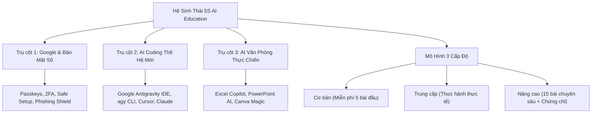
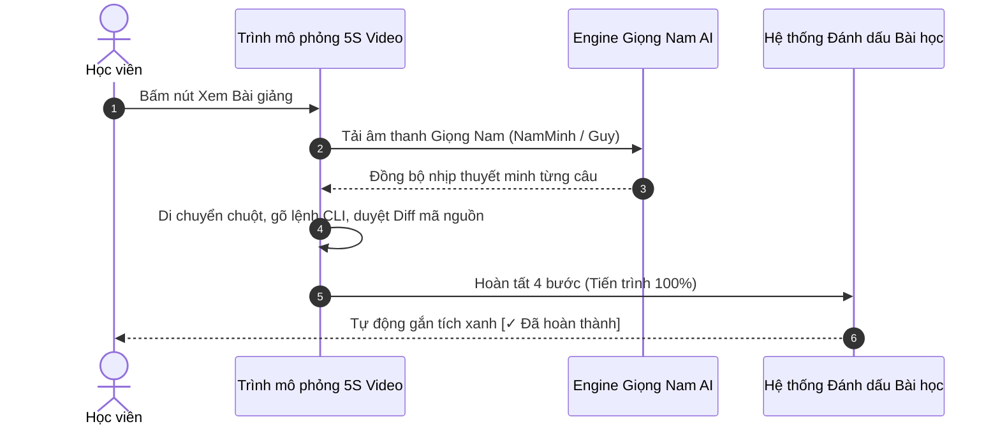
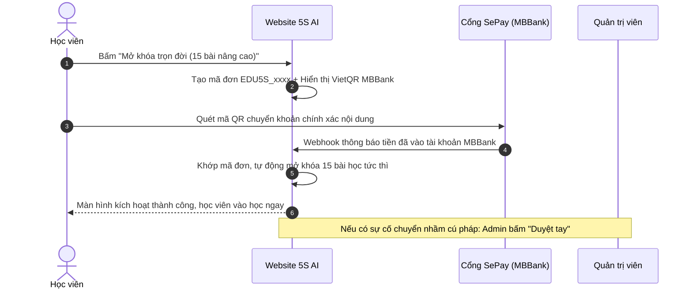
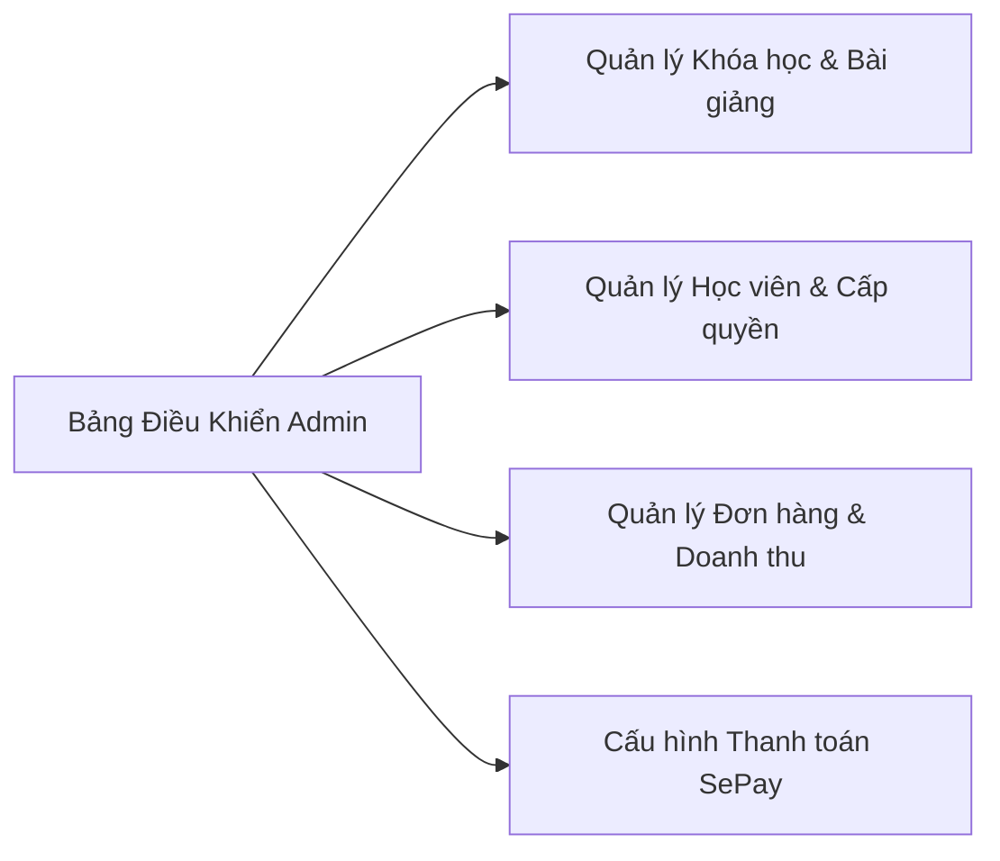

# TỔNG HỢP TOÀN DIỆN CHỨC NĂNG & QUY TRÌNH VẬN HÀNH
## NỀN TẢNG ĐÀO TẠO TRỰC TUYẾN 5S AI EDUCATION (5S TECHNOLOGY)

> **Kính gửi:** Ban Lãnh đạo & Quản lý Dự án Công ty Phát triển Công nghệ 5S  
> **Đơn vị thực hiện:** Đội ngũ Kỹ thuật & Phát triển Sản phẩm 5S AI  
> **Địa chỉ Website chính thức:** [https://edu5s.vercel.app](https://edu5s.vercel.app)  
> **Mã nguồn GitHub:** [https://github.com/ngoisaocodon2202/edu5s](https://github.com/ngoisaocodon2202/edu5s)  
> **Ngày cập nhật:** Tháng 11/2026

---

## 1. TỔNG QUAN DỰ ÁN & ĐỊNH VỊ THỊ TRƯỜNG

**5S AI Education** là nền tảng đào tạo trực tuyến thực chiến tiên phong tại Việt Nam, tập trung giải quyết bài toán: **Ứng dụng Trí tuệ Nhân tạo thế hệ mới (AI Agents) kết hợp Bảo mật số toàn diện** cho 3 nhóm đối tượng: Học sinh - Sinh viên, Người đi làm (Cá nhân) và Doanh nghiệp (B2B L&D).

### Các giá trị cốt lõi:
- **Chuẩn hóa 3 Cấp độ rõ ràng:** Cơ bản (Beginner) $\rightarrow$ Trung cấp (Intermediate) $\rightarrow$ Nâng cao (Advanced).
- **Chính sách hỗ trợ cộng đồng:** Miễn phí hoàn toàn 5 bài học nền tảng thiết yếu của mọi khóa học cho đối tượng Học sinh - Sinh viên.
- **Học thực chiến qua mô phỏng:** Không chỉ học lý thuyết tĩnh, học viên được tương tác trực tiếp với giao diện phần mềm thực tế thông qua trình giả lập độc quyền **5S AI Video Simulator**.

---

## 2. KIẾN TRÚC KỸ THUẬT & HỆ THỐNG CÔNG NGHỆ

Hệ thống được thiết kế theo tiêu chuẩn hiện đại, tốc độ phản hồi dưới 0.3s, tối ưu SEO, hỗ trợ đa thiết bị (Responsive Mobile / Tablet / Desktop) và bảo mật dữ liệu đa tầng.

| Thành phần | Công nghệ sử dụng | Mục đích & Ưu điểm |
| :--- | :--- | :--- |
| **Giao diện (Frontend)** | React 18, Vite 5, Tailwind CSS | Tốc độ tải trang cực nhanh, giao diện Sáng (Light Mode) thanh lịch chuẩn Coursera. |
| **Đa ngôn ngữ (i18n)** | Custom Engine (VI - EN) | Chuyển đổi tức thì giữa Tiếng Việt và Tiếng Anh mà không cần reload trang. |
| **Âm thanh AI (TTS)** | Neural Edge Voice (`msedge-tts`) | Giọng đọc Nam trầm ấm, tự nhiên, không bị giật rè, chuẩn ngữ điệu kỹ thuật. |
| **Cơ sở dữ liệu** | PostgreSQL 16 (Wire Protocol :5432) | Lưu trữ người dùng, khóa học, đơn hàng đồng bộ thời gian thực. |
| **Cổng thanh toán** | SePay Banking Automation | Đối soát tự động qua mã VietQR MBBank, kích hoạt khóa học tức thì 24/7. |
| **Hạ tầng Cloud** | Vercel Edge Global CDN | Tự động cân bằng tải, bảo mật SSL, uptime 99.99%. |

---

## 3. CHI TIẾT CÁC TÍNH NĂNG NỔI BẬT DÀNH CHO HỌC VIÊN

### 3.1. Trình phát Video Học tập Thực chiến (Interactive Video Simulator)
Khác biệt hoàn toàn so với các nền tảng video thụ động thông thường, mỗi bài học được xây dựng theo quy trình 4 bước chuẩn thao tác thực tế:

- **Môi trường thao tác thực tế theo từng trụ cột:**
  - *Với mảng AI Coding:* Giao diện chuẩn **Google Antigravity IDE**, cửa sổ dòng lệnh gõ lệnh `agy --workspace eduAI`, phím tắt `Ctrl + I` phân tích mã nguồn và khung kế hoạch phụ `implementation_plan.md`.
  - *Với mảng Bảo mật Google:* Giao diện trình duyệt Chrome mở `myaccount.google.com/security`, rà soát phiên đăng nhập lạ, bật xác minh 2 bước 2FA và tạo khóa sinh trắc học **Passkeys (FIDO2)**.
  - *Với mảng Văn phòng AI:* Giao diện bảng tính Excel kết hợp **Copilot AI Studio**, tự động viết hàm `XLOOKUP`, tự động vẽ biểu đồ tăng trưởng và xuất Slide PowerPoint chuẩn nhận diện 5S.
- **Thuyết minh giọng Nam đồng nhất:**
  - Tiếng Việt: Giọng Nam chuẩn `vi-VN-NamMinhNeural`.
  - Tiếng Anh: Giọng Nam chuẩn `en-US-GuyNeural`.
  - Đã tích hợp bộ lọc từ vựng công nghệ đặc thù, phát âm chính xác các thuật ngữ: *Antigravity IDE, agy, CLI, VS Code, Passkeys, 2FA, PostgreSQL, XLOOKUP*.
- **Tự động lưu tiến độ:** Khi học viên xem hết bài học (hoặc làm xong bài tập), hệ thống tự động ghi nhận và hiển thị dấu tích xanh `✓ Đã hoàn thành` trong danh mục 20 bài học.

### 3.2. Cơ chế Bảo vệ Bản quyền & Chống Ghi hình (5S-DRM Protection)
Nhằm bảo vệ tài sản trí tuệ và bài giảng của công ty, trình phát video được trang bị lớp bảo mật nghiêm ngặt:
- **Logo Watermark cố định:** Logo thương hiệu 5S AI Education luôn hiển thị nổi bật ở góc trên bên trái khung hình kèm nhãn `5S AI LIVE`.
- **Thủy vân số định danh (Forensic Watermark):** Hiển thị email học viên mờ ngẫu nhiên trên màn hình (`5S-DRM • user@email.com • NO SCREEN RECORDING`) nhằm răn đe chia sẻ tài khoản.
- **Chống tải về (Anti-Download):** Khóa hoàn toàn chuột phải (`onContextMenu`), khóa kéo thả (`onDragStart`), không để lộ link stream video trực tiếp.
- **Chống chụp và quay màn hình (Anti-Screen Recording):**
  - Chặn các phím tắt nguy hiểm: `PrintScreen`, `F12` (DevTools), `Ctrl + S`, `Ctrl + U`, `Ctrl + Shift + I/C/S`, phím tắt chụp ảnh macOS (`Cmd + Shift + 3/4/5`).
  - Tự động tạm dừng và khóa nội dung ngay lập tức khi học viên chuyển tab (`visibilitychange`) hoặc khi phát hiện luồng `getDisplayMedia` ghi màn hình.

### 3.3. Hệ thống Bài tập Thực hành & Đánh giá Năng lực
- Mỗi bài học nâng cao đều đi kèm tab **Bài Tập Thực Hành & Kiểm Tra**.
- Câu hỏi tình huống trắc nghiệm sát với bài học thực tế, phản hồi kết quả và giải thích chi tiết ngay khi học viên nộp bài.

### 3.4. Đăng ký & Đăng nhập Thân thiện, An toàn
- Tích hợp nút **Ẩn / Hiện mật khẩu** (mắt đóng/mở) ở cả 2 form Đăng nhập và Đăng ký.
- Cho phép học viên lựa chọn vai trò ngay khi tạo tài khoản: *Học sinh - Sinh viên*, *Cá nhân*, hoặc *Doanh nghiệp*.
- Hỗ trợ đăng nhập nhanh bằng tài khoản Google.

---

## 4. QUY TRÌNH THANH TOÁN & ĐỐI SOÁT TỰ ĐỘNG (SEPAY WORKFLOW)

Hệ thống thanh toán được tự động hóa hoàn toàn từ bước tạo đơn đến kích hoạt quyền học:

1. **Tạo mã QR động thông minh:**
   - Mã VietQR nạp sẵn: Số tài khoản MBBank (`789220206`), Tên chủ tài khoản (`CONG TY PHAT TRIEN CONG NGHE 5S`), Số tiền chính xác và Nội dung chuyển khoản duy nhất (Ví dụ: `EDU5S_1731089201`).
2. **Xử lý Webhook tức thì (Real-time):**
   - Khi tiền về tài khoản MBBank của công ty, SePay đẩy tín hiệu Webhook về máy chủ 5S AI.
   - Máy chủ kiểm tra số tiền và mã đơn, lập tức chuyển trạng thái sang `completed` và kích hoạt toàn bộ 15 bài học nâng cao cho tài khoản của học viên.
3. **Cơ chế duyệt dự phòng (Admin Manual Approval):**
   - Trường hợp học viên ghi sai nội dung chuyển khoản, quản trị viên chỉ cần vào Trang Quản trị và bấm nút **Duyệt Đơn** để mở khóa tức thì.

---

## 5. TRANG QUẢN TRỊ DÀNH CHO NỘI BỘ (ADMIN DASHBOARD)

Trang Quản trị được thiết kế chuyên biệt để ban quản lý nắm bắt toàn diện số liệu kinh doanh và vận hành:

### Các phân hệ chính:
1. **Thống kê tổng quan:** Tổng số học viên, doanh thu lũy kế, tỷ lệ hoàn thành bài học, số đơn hàng đang chờ duyệt.
2. **Quản lý Khóa học:**
   - Xem toàn bộ danh sách 60 khóa học thuộc 3 trụ cột và 3 cấp độ.
   - Thêm mới, chỉnh sửa tiêu đề, mô tả, công cụ đào tạo, biểu phí, thời lượng học.
3. **Quản lý Học viên:**
   - Tìm kiếm học viên theo Tên hoặc Email.
   - Xem danh sách các khóa học học viên đã mua/mở khóa.
   - Cấp quyền mở khóa trực tiếp cho các tài khoản đặc biệt (nhân viên nội bộ, đối tác).
4. **Quản lý Đơn hàng (Orders):**
   - Bảng tra cứu tất cả giao dịch chuyển khoản MBBank.
   - Lọc đơn: *Đã duyệt*, *Chờ thanh toán*, *Đã hủy*.
   - Nút thao tác nhanh: Duyệt thủ công, Hủy đơn, Xuất biên lai.
5. **Cấu hình Cổng SePay:**
   - Cho phép giám đốc hoặc kế toán thay đổi số tài khoản ngân hàng, tên người thụ hưởng và API Token trực tiếp trên giao diện mà không cần can thiệp vào code.

---

## 6. HƯỚNG DẪN QUY TRÌNH VẬN HÀNH HÀNG NGÀY CHO DOANH NGHIỆP

| Thời điểm | Bộ phận phụ trách | Nhiệm vụ cụ thể |
| :--- | :--- | :--- |
| **Đầu ngày (08:30)** | Kế toán / CSKH | Kiểm tra mục **Quản lý Đơn hàng**: Đối soát sao kê app ngân hàng MBBank với danh sách đơn hàng `completed` trên hệ thống. |
| **Trong ngày** | Bộ phận Hỗ trợ (CSKH) | Trực hotline/Zalo (`0862034101`), giải đáp thắc mắc về khóa học, hỗ trợ học viên gặp lỗi quên mật khẩu hoặc nhập sai mã chuyển khoản. |
| **Khi có khóa học mới** | Ban Đào tạo / Giảng viên | Vào Admin Dashboard $\rightarrow$ Thêm khóa học mới $\rightarrow$ Nhập danh mục 20 bài học kèm nội dung thực hành và kịch bản video. |
| **Định kỳ hàng tuần** | Kỹ thuật (IT/Dev) | Kiểm tra nhật ký lỗi trên Vercel, sao lưu dữ liệu PostgreSQL, cập nhật các bài giảng công nghệ AI mới nhất (Antigravity v2, Claude 3.5, Gemini 2.5). |

---

## 7. KẾ HOẠCH PHÁT TRIỂN & MỞ RỘNG (GIAI ĐOẠN TIẾP THEO)

1. **Cấp Chứng chỉ Tốt nghiệp Blockchain/NFT:** Học viên hoàn thành đủ 20 bài học và vượt qua bài thi thực hành sẽ được cấp mã chứng chỉ số có thể đính kèm trên LinkedIn.
2. **Tính năng Doanh nghiệp (B2B Corporate Portal):** Cho phép doanh nghiệp mua gói đào tạo theo lô (seat license) và theo dõi dashboard tiến độ học của từng nhân viên phòng ban.
3. **Hệ thống AI Chatbot Trợ giảng 24/7:** Tích hợp trực tiếp trợ lý Gemini 2.5 Pro vào góc phải bài học để giải đáp bài tập lập trình và gỡ lỗi code ngay trong lúc xem video.

---

> **Kết luận:** Nền tảng **5S AI Education** đã hoàn thiện toàn diện về mặt sản phẩm, trải nghiệm học viên, hệ thống thanh toán tự động và hạ tầng bảo mật DRM. Sản phẩm sẵn sàng 100% để công ty đưa vào vận hành thương mại và triển khai chiến dịch truyền thông tuyển sinh.
